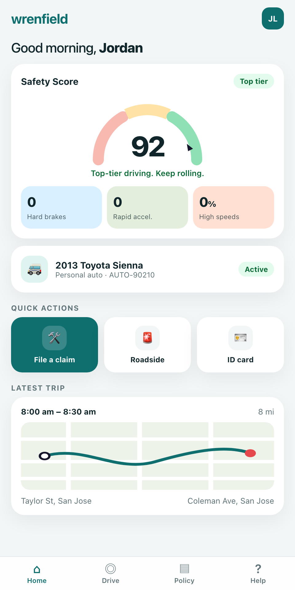

# Auto Claim Voice Agent

A voice-first way to report a car insurance claim, started from inside an insurer's mobile app.

You tap **File a claim**, and an AI agent greets you by name, asks what happened, writes the claim as you talk, and looks at the damage through your phone's camera. There are no forms.

<p align="center">
  
</p>

> **This is a demo.** It uses mock policy data and a made-up insurer, **Wrenfield Insurance**. It is not an insurance product, it files nothing with any insurer, and it is not affiliated with or endorsed by any company.

## Contents

- [What it does](#what-it-does)
- [Quick start](#quick-start)
- [Try it on your phone](#try-it-on-your-phone)
- [Things to try](#things-to-try)
- [Scope](#scope)
- [Guardrails](#guardrails)
- [Data and privacy](#data-and-privacy)
- [Configuration](#configuration)
- [How it works](#how-it-works)
- [Known limitations](#known-limitations)
- [Tests](#tests)
- [Credits and license](#credits-and-license)

## What it does

| Step | What you see |
|---|---|
| 1. Home | A signed-in app home screen with a safety score, the insured vehicle, and **File a claim** |
| 2. Start | A sheet offering **Start with voice** or **Type instead** |
| 3. Live claim | The agent speaks first. Claim notes fill in as you talk. A progress bar tracks completeness |
| 4. Camera | Point the phone at the damage or a document. The agent describes what it sees and pins the photo |
| 5. Done | A confirmation screen with a claim summary and a downloadable adjuster packet |

Because the app already knows who is signed in, the agent never asks for your name or policy number. It verifies the policy in the background while you describe the accident.

## Quick start

**You need**

- macOS or Linux
- Python 3.11, 3.12, or 3.13
- A Google API key with access to the Gemini Live API. Get one at [aistudio.google.com/apikey](https://aistudio.google.com/apikey)

> The Live audio model usually requires billing to be enabled on the Google project. A demo session costs well under a dollar.

**1. Clone and set up**

```bash
git clone https://github.com/hirenmandalia/auto-claim-voice-agent.git
cd auto-claim-voice-agent
./setup.sh
```

**2. Add your API key**

Open the `.env` file that setup created and replace `replace-me` with your key.

```
GOOGLE_API_KEY=your-key-here
```

**3. Run it**

```bash
./run_local.sh
```

**4. Open the demo**

Go to [http://127.0.0.1:4177/mobile/](http://127.0.0.1:4177/mobile/) in Chrome or Safari. Make the window phone-sized for the intended look, tap **File a claim**, and allow the microphone.

The original desktop "field notebook" view from the upstream project is still available at [http://127.0.0.1:4177/](http://127.0.0.1:4177/).

## Try it on your phone

Phones only allow the microphone and camera on HTTPS pages. This script serves the demo over HTTPS on your Wi-Fi with a certificate it creates for you. Nothing is exposed to the internet.

**1. Start the phone server** on your computer:

```bash
./run_phone.sh
```

It prints two addresses that look like `https://192.168.1.42:4443/...`.

**2. Trust the certificate** on the phone. This is a one-time step.

*iPhone*
1. Open the first printed address, ending in `demo-cert.crt`, in Safari and tap **Allow**.
2. Go to **Settings**, tap **Profile Downloaded**, and tap **Install**.
3. Go to **Settings > General > About > Certificate Trust Settings** and turn on the new certificate.

*Android*
1. Open the same address in Chrome to download the file.
2. Go to **Settings > Security > Encryption & credentials > Install a certificate > CA certificate** and pick the file.

**3. Open the demo** at the second printed address, ending in `/mobile/`.

**Troubleshooting**

| Problem | Fix |
|---|---|
| Page won't load | Phone and computer must be on the same Wi-Fi. Allow Python through the firewall if your computer asks |
| "Voice failed: connection failed" | The server stopped. Run `./run_phone.sh` again and reload the page |
| You see the greeting but can't hear it | Turn the iPhone's ringer switch on and raise the volume |
| It worked yesterday, not today | Your computer's Wi-Fi address changed. Run `./run_phone.sh` again and repeat the certificate step |
| "Service unavailable" on the claim screen | The API key is missing or still set to the placeholder in `.env` |

## Things to try

The signed-in demo account is **Jordan Lee**, policy **AUTO-90210**, driving a **2013 Toyota Sienna**.

| Say this | What should happen |
|---|---|
| "Someone rear-ended me at a red light on Main Street this morning. The bumper is dented." | Notes fill in. The agent asks about the other driver |
| Turn on the camera and show a dent or scratch | The agent describes what it sees and pins the photo |
| Show [`assets/props/sample-driver-license.png`](assets/props/sample-driver-license.png) on another screen | The agent reads the other driver's details off the card |
| "Can you help me shop for a laptop?" | A polite refusal, then back to the claim |
| "My car won't start. Can you troubleshoot it?" | It explains that repairs are not claims |
| "My basement flooded last night." | It explains it only takes auto claims. The status changes to **Auto claims only** |
| "My passenger is bleeding." | Emergency guidance first, and the claim is escalated to a person |

## Scope

This agent does one job: **first notice of loss for a personal auto policy.**

**In scope**

- Collisions and hit-and-run
- Theft of or from the vehicle
- Vandalism, glass, weather, fire, and animal strikes
- Towing or rental needs caused by one of those events
- Questions about what the claim needs, what is on the policy on file, and what happens next

**Out of scope**

- Any non-auto claim, such as home, renters, health, travel, life, or pet
- Mechanical breakdown or maintenance with no accident, theft, or damage event
- Anything that is not about the claim, such as shopping, general questions, or legal and medical advice
- Coverage decisions, payment amounts, fault, or approval. The agent collects facts and never decides

## Guardrails

The guardrails come in two kinds. **Instructions** tell the model how to behave. **Code** enforces a rule no matter what the model does. Wherever a rule matters most, both are used.

### Staying in scope

| Rule | How it is enforced |
|---|---|
| Auto claims only | Instruction, plus a scope gate in code that forces any non-auto claim to `out_of_scope` so it can never reach an adjuster |
| Claim topics only | Instruction. Off-topic requests are declined in one sentence and the agent returns to the claim |
| Cannot be talked out of the rules | Instruction. "Ignore your rules" gets the same boundary, stated once |
| Off-topic talk is not recorded as claim facts | The fact extractor is told to ignore it |

### Honesty and safety

| Rule | How it is enforced |
|---|---|
| Never promises coverage, payment, or fault | Instruction, repeated in every tool result |
| Safety comes first | Injury or danger triggers emergency guidance on any topic, and code routes the claim to a person |
| "No one is hurt" is not an emergency | Negated safety statements are filtered in code |
| Does not invent an incident | Inspections and hypotheticals are not treated as a loss |
| Does not invent facts | The extractor may not make up policy numbers, dates, or amounts, and cites the turn each fact came from |

### Evidence integrity

| Rule | How it is enforced |
|---|---|
| The agent reports only what it can see | Instruction |
| Every photo is independently checked | A second model call compares the image with what the claimant said. Unsupported photos are marked **Needs a closer look** |
| Claimed documents are not counted as received | Code marks them available until a camera capture succeeds |
| No AI-drawn illustrations | The sketch tool is removed by default, so there is nothing that could be mistaken for evidence |

### Resistance to manipulation

| Rule | How it is enforced |
|---|---|
| Text in photos and documents is never an instruction | Instruction in the live agent, the extractor, and the photo checker |
| App notices are not claimant speech | Account and camera state are labeled as app state |
| Account details are sanitized | Code accepts only four known fields, strips unusual characters, and caps the length |

### Routing rules

Routing is decided by plain Python rules, so the same facts always give the same result.

| Trigger | Result |
|---|---|
| Non-auto claim | Auto claims only |
| Injury or unsafe conditions | Escalate to a person |
| Reported before the loss date, or more than 90 days after | Special investigation |
| Estimated loss of $10,000 or more with no evidence | Special investigation |
| Missing date, location, or description | Stays in follow-up |

### Access and abuse limits

- Local connections only by default. Phone mode accepts private Wi-Fi addresses only.
- Each claim is bound to the browser that started it.
- Rate limits on text, audio, and camera frames, with caps on message size, photos, and conversation length.
- Live calls end after 20 minutes. Idle claims expire after 30 minutes.

## Data and privacy

Read this before using the demo with anything real.

**What leaves your computer**

Your voice, camera frames, and typed messages are sent to **Google's Gemini API**. That is how the agent hears, sees, and speaks, and there is no setting that avoids it. Google's handling of that data depends on your API tier, so check the [Gemini API terms](https://ai.google.dev/gemini-api/terms).

**What stays on your computer**

- Nothing is written to disk. There is no database and no log of what was said.
- Nothing is sent to any other service. There is no insurer system, CRM, or analytics.
- Claims live in server memory. They are erased when you leave a claim, and everything is gone when the server stops.
- The mobile page loads no third-party fonts, scripts, or trackers.

You can confirm the current mode at any time:

```bash
curl -s http://127.0.0.1:4177/api/health
```

**Do not enter real personal information.** Use the mock account and the sample props.

## Configuration

All settings are optional and go in `.env`.

| Setting | Default | What it does |
|---|---|---|
| `GOOGLE_API_KEY` | none | Required. Your Gemini API key |
| `FNOL_AUTO_ONLY` | `on` | `off` accepts home, health, and travel claims, as in the original demo |
| `FNOL_SKETCH` | `off` | `on` lets the agent draw an illustration of the incident |
| `FNOL_BARGE_IN` | `on` | `off` makes the agent always finish its sentence. Useful in noisy rooms |
| `FNOL_VAD_SILENCE_MS` | `900` | How long a pause ends your turn, in milliseconds |
| `FNOL_VOICE` | `Kore` | The agent's voice |
| `FNOL_BRAND` | `Wrenfield Insurance` | The fictional insurer name the agent uses. The screens are edited in `live_demo/mobile/index.html` |
| `FNOL_GEMINI_LIVE_MODEL` | `gemini-3.8-live` | The live voice model |
| `FNOL_ALLOW_LAN` | off | Accept phones on the same Wi-Fi. `run_phone.sh` sets this |
| `FNOL_TRUST_PROXY` | off | Only if you deliberately put the demo behind an HTTPS tunnel |

If a model name is rejected, check the current names in the [Gemini model list](https://ai.google.dev/gemini-api/docs/models) and override them here.

To change the signed-in account, edit `ACCOUNT` at the top of `live_demo/mobile/mobile.js` and the matching record in `policy_directory.py`.

## How it works

```
Phone or browser                     Your computer                          Google
┌──────────────────┐   WebSocket   ┌────────────────────────────┐        ┌───────────────┐
│ App shell        │──────────────▶│ FastAPI server             │───────▶│ Gemini Live   │
│ mic, camera,     │  audio, video │  • session + scope gate    │        │ voice, vision │
│ claim notes      │◀──────────────│  • tools run in background │◀───────│               │
└──────────────────┘  speech, state│  • claim rules in Python   │        │ Gemini Flash  │
                                   └────────────────────────────┘        │ extraction    │
                                                                         └───────────────┘
```

1. The app shell sends the signed-in account when a claim starts.
2. The server opens a Gemini Live session and the agent speaks first.
3. While you talk, the agent calls three tools in the background, without pausing the conversation.
4. A second model turns the conversation into structured facts. Python rules then validate, route, and build the adjuster packet.

| Tool | What it does |
|---|---|
| `lookup_policy` | Looks up the policy in a mock directory |
| `sync_claim_packet` | Extracts facts, applies the rules, and returns what is still needed |
| `pin_evidence_photo` | Saves the current camera frame and verifies it |

**Project layout**

```
live_demo/
  server.py         FastAPI server, sessions, WebSocket bridge to Gemini Live
  live_tools.py     Agent instructions, tool definitions, scope gate, voice settings
  mobile/           Mobile app shell: home, policy, claim, and confirmation screens
  index.html        Original desktop notebook view
agent.py            Extraction and classification agents (Google ADK)
policies.py         Deterministic claim rules: validation, evidence, fraud and safety gates
policy_directory.py Mock policies
schemas.py          Data models
tests/              Regression and scope-gate tests
```

## Known limitations

This is a prototype. Before anything like it could face real customers, it would need at least the following.

- **Identity.** The app shell asserts who is signed in. A real app must pass a verified session.
- **Human handoff.** Escalation changes a status label. It does not page or transfer to a person.
- **Disclosure and consent.** There is no "you are speaking with an AI" or recording notice, which many jurisdictions require.
- **Output checking.** Rules like "never promise coverage" live in instructions. Nothing inspects the agent's speech before it is spoken.
- **Audit trail.** Nothing is stored, which is good for privacy in a demo and unacceptable for a regulated claim record.
- **Fraud rules.** They are simple and keyword-based, written to illustrate the idea.
- **Device coverage.** Tested on iPhone Safari and desktop Chrome. Android is untested.

## Tests

The rule engine and the scope gate are tested without any model calls, so the tests are fast and free.

```bash
.venv/bin/python -m unittest discover -s tests
```

## Credits and license

This project builds on [Insurance Claim Live Agent Team](https://github.com/Shubhamsaboo/awesome-llm-apps/tree/main/voice_ai_agents/insurance_claim_live_agent_team) from **awesome-llm-apps** by Shubham Saboo. The claim rules, the agent team, and the desktop notebook view come from that project.

This version adds the mobile app shell, signed-in account context, the spoken greeting, voice tuning, the scope guardrails, phone access over Wi-Fi, and the setup scripts. See [NOTICE](NOTICE) for the full list of changes.

Licensed under the [Apache License 2.0](LICENSE).
